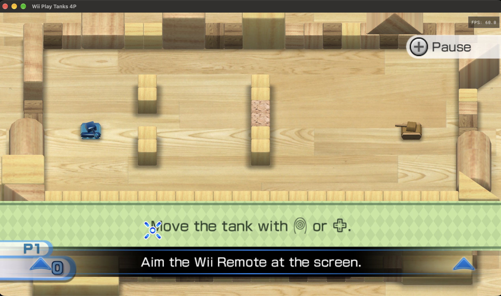

# Wii Play — native recompilation

**Wii Play (USA, RHAE01) running natively on macOS**, statically recompiled from your own disc —
no emulator. All nine games run, including **Tanks!**, with menus, Miis, audio, saves and
keyboard/mouse controls.

Built on [WiiCompiled](https://github.com/patchzyy/Wiicompiled), the static recompiler and runtime
made for Mario Kart Wii, by way of the
[Wario Land: Shake It! port](https://github.com/santiagovalencia109/Wario-Land-Shake-It-Native-PC).
Next goal: **4-player Tanks!** (the original supports at most two).



> **No Nintendo code or data is included.** You need your own Wii Play disc image; the build
> extracts and recompiles it locally. Nothing from the disc is ever committed.

## Status

| | |
|---|---|
| Boot, menus, Mii select, saves | ✅ |
| All 9 minigames incl. Tanks! | ✅ playable |
| Audio | ✅ |
| Graphics | ✅ mostly correct; occasional lighting oddities |
| Controls | keyboard + mouse (pointer), optional keyboard player 2 |
| Platforms | macOS on Apple Silicon (played). Windows x64 and Linux: build scripts included, not tested yet |

## Requirements

- Your own **Wii Play (USA) RHAE01** disc image (ISO, NKit ISO, WBFS, RVZ…)
- Mii data from the Wii system software (see [Mii data](#mii-data)) — [Dolphin](https://dolphin-emu.org) can download it from Nintendo
- Python 3 and about 6 GB of free disk space for the build
- **macOS:** Apple Silicon or Intel, macOS 14+, Xcode Command Line Tools, [Homebrew](https://brew.sh)
- **Windows:** 64-bit Windows 10/11 and [Python 3](https://www.python.org/downloads/). Everything else
  (LLVM-MinGW, CMake, Ninja, .NET 8) is downloaded into `tools\` by the build script
- **Linux:** x86_64 or aarch64, clang, CMake, Ninja, the .NET 8 SDK and SDL's build dependencies:

  ```sh
  sudo apt install clang lld cmake ninja-build pkg-config dotnet-sdk-8.0 libx11-dev libxext-dev \
    libxrandr-dev libxcursor-dev libxfixes-dev libxi-dev libxss-dev libxtst-dev libxkbcommon-dev \
    libwayland-dev libdecor-0-dev libegl1-mesa-dev libgl1-mesa-dev libdrm-dev libgbm-dev \
    libasound2-dev libpulse-dev libpipewire-0.3-dev libdbus-1-dev libudev-dev libibus-1.0-dev \
    libusb-1.0-0-dev libvulkan-dev
  ```

Graphics go through WebGPU ([Dawn](https://dawn.googlesource.com/dawn)), which uses Metal on macOS,
Direct3D 12 or Vulkan on Windows and Vulkan on Linux.

## Build

Put your disc image in a `disc/` folder in the repository, then:

| | |
|---|---|
| macOS | `./setup-mac.sh` (Homebrew tools + disc extraction), then `python3 scripts/build.py build` |
| Windows | double-click `Build-Windows.cmd` (or `py -3 scripts\build.py all`) |
| Linux | `python3 scripts/build.py all` |

`scripts/build.py` does three steps you can also run on their own: `setup` (downloads
[nodtool](https://github.com/encounter/nod) and extracts the disc into `extracted/`), `configure`
(builds the translator and configures CMake into `build/native`) and `build [--skip-translate]`
(translates `main.dol` to C++ and compiles). The first build takes a while: it translates ~14,000
functions and compiles them. Run the game with `build/native/WiiCompiled` (`WiiCompiled.exe` on Windows).

## Mii data

Wii Play needs the console's Mii parts file (`RFL_Res.dat`), which comes with the Wii system
software, not the game disc. With Dolphin:

1. **Tools → Perform Online System Update** (downloads the official Wii Menu from Nintendo).
2. **Tools → Load Wii System Menu**, finish setup, open the **Mii Channel** and make a Mii.
3. Copy two files from Dolphin's Wii folder into this port's virtual NAND,
   `build/native/UserData/NAND/shared2/menu/FaceLib/` (create it if needed):

| From (inside Dolphin's `Wii` folder) | To (in `FaceLib/`) |
|---|---|
| `title/00010002/48414341/content/00000017.app` | `RFL_Res.dat` |
| `shared2/menu/FaceLib/RFL_DB.dat` | `RFL_DB.dat` |

Dolphin's `Wii` folder is `~/Library/Application Support/Dolphin/Wii` on macOS,
`%APPDATA%\Dolphin Emulator\Wii` (or `Documents\Dolphin Emulator\Wii`) on Windows and
`~/.local/share/dolphin-emu/Wii` on Linux. On macOS:

```sh
D=build/native/UserData/NAND/shared2/menu/FaceLib; mkdir -p "$D"
cp ~/Library/Application\ Support/Dolphin/Wii/title/00010002/48414341/content/00000017.app "$D/RFL_Res.dat"
cp ~/Library/Application\ Support/Dolphin/Wii/shared2/menu/FaceLib/RFL_DB.dat "$D/RFL_DB.dat"
```

Optional: `python3 scripts/unlock_all_games.py` unlocks all nine games in an existing save
(it backs the save up first).

## Controls

| Wii Remote | Player 1 | Player 2 (`WIIPLAY_KEYBOARD_P2=1`) |
|---|---|---|
| Pointer | mouse | T F G H |
| A | left click / **A** | **U** |
| B | right click / **B** | **O** |
| D-pad | arrow keys | I J K L |
| + / − | Enter / Tab | Y / P |

A connected gamepad also works as a remote. Player 2 on the keyboard is for testing multiplayer:
`WIIPLAY_KEYBOARD_P2=1 build/native/WiiCompiled`.

## How it works

1. **Function map** — `scripts/build_map.sh` finds the ~14,000 functions in `main.dol`
   (calls, vtables, member-function pointers, callback tables) and names Nintendo SDK functions
   with Dolphin's signature database, link-order alignment against the Wario port and hand
   analysis (`projects/wiiplay/MAP_manual.txt`).
2. **Translation** — WiiCompiled's translator turns every function into C++.
3. **Runtime** — native replacements ("HLE") for the SDK: OS, graphics (via
   [aurora](https://github.com/encounter/aurora) on Metal), audio, disc, NAND, input.
   The runtime was written for other games, so `scripts/retarget_runtime.py` moves each
   replacement to Wii Play's address, and every hard-coded SDK variable was re-derived from
   Wii Play's own code (`scripts/ppcdis.py` helps read it).

Wii Play uses an older SDK (2006–07) than the games WiiCompiled was built for, so a lot of the
work was finding where that SDK differs: NAND/ISFS behaviour, Mii (RFL) loading, display-list and
draw-done handling, VI frame-buffer bookkeeping and more. Comments starting with `WII PLAY:` in
`runtime/` explain each change.

## Credits

- [WiiCompiled](https://github.com/patchzyy/Wiicompiled) by patchzyy and contributors — translator and runtime
- [Wario Land: Shake It! native port](https://github.com/santiagovalencia109/Wario-Land-Shake-It-Native-PC) — the runtime adaptation this port started from
- [aurora](https://github.com/encounter/aurora), [nod](https://github.com/encounter/nod), [Dolphin](https://dolphin-emu.org) (signature database), and the libraries listed in [THIRD-PARTY-NOTICES.md](THIRD-PARTY-NOTICES.md)

This port was developed with heavy help from an AI coding assistant (Claude), directed and
play-tested by a human.

## License

GPL-3.0 — see [LICENSE](LICENSE). Third-party components keep their own licenses
([THIRD-PARTY-NOTICES.md](THIRD-PARTY-NOTICES.md)). Wii Play and all related content are
© Nintendo; this project contains none of it and is not affiliated with Nintendo.
